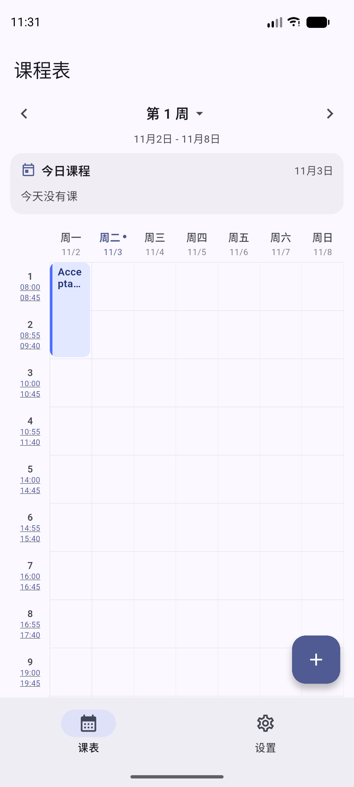
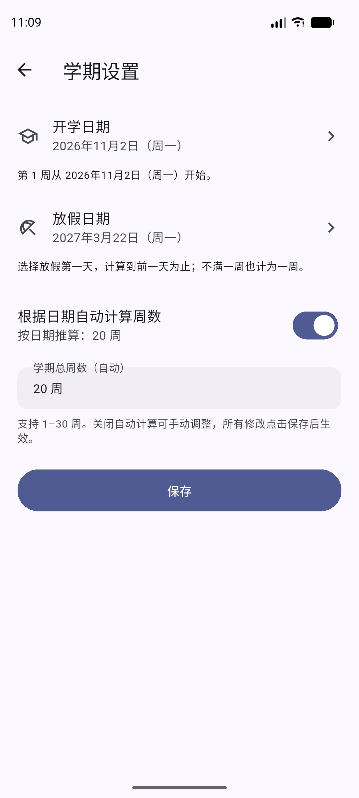

# 课程表 App

一款面向 Android 的本地课程表应用，使用 Flutter 开发。无需注册账号，课程和学期数据保存在设备 SQLite 数据库中，支持 JSON 备份与恢复。

**版本：1.2.0+4 · 真机覆盖更新、数据与设置保留已由使用者确认；应用内更新与局域网验收见 [更新指南](docs/IN_APP_UPDATE.md)。线上更新源尚未配置。**

## 功能

| 模块 | 1.0 功能 |
| --- | --- |
| 课程管理 | 新增、编辑、查看、删除课程；设置名称、教师、地点、颜色和备注 |
| 上课安排 | 每门课支持多个时段；配置星期、起止节次、起止周和单双周 |
| 周课表 | 周一至周日网格、跨节次课程合并、重叠课程并排显示、今日课程卡片 |
| 周次导航 | 上一周 / 下一周、选择周次、回到本周、当天高亮 |
| 学期设置 | 选择开学日期和放假日期，自动推算周数；也可手动选择 1–30 周 |
| 节次时间 | 自定义每节上下课时间，添加或删除末尾节次；课表侧栏同时显示上下课时间并支持点击修改 |
| 冲突检测 | 保存时检查星期、节次和周次交集，确认后可保留冲突课程 |
| 上课提醒 | 本地通知，默认提前 15 分钟，可调整或关闭；课程和设置变化后重新排程 |
| 备份恢复 | 导出 JSON 文件并分享；从剪贴板或文件路径覆盖导入，写入前完整解析和校验 |
| 显示主题 | 跟随系统、浅色、深色 |

## 界面预览

截图来自 Pixel 7 模拟器，使用测试课程。

<table>
  <tr>
    <td align="center">周课表与上下课时间</td>
    <td align="center">学期日期与自动周数</td>
  </tr>
  <tr>
    <td></td>
    <td></td>
  </tr>
</table>

## 使用方式

1. 首次启动时设置开学日期、放假日期，确认自动推算的周数，或切换为手动选择。
2. 添加课程，并添加至少一个上课时段；支持一门课每周上多次。
3. 在周课表中查看课程，单击课程查看详情，双击空白格添加该时段课程；点击左侧时间可修改该节上下课时间。
4. 在设置中调整学期、节次和提醒，或导出备份。

### 学期周数规则

- 第 1 周从开学日期所在周的周一开始，保留用户实际选择的开学日期。
- 放假日期指**放假第一天**，自动计算到其前一天为止，不满一周也计为一周。
- 例如：2026 年 9 月 2 日开学、9 月 14 日放假，对应 8 月 31 日开始的第 1 周和 9 月 7 日开始的第 2 周，共 2 周。
- 关闭“根据日期自动计算周数”后，可手动选择 1–30 周。日期和模式均会保存；点击“保存”后生效。
- 若自动结果超出 1–30 周，页面会提示调整日期或改用手动模式。

### 数据与提醒

- 卸载应用或清除应用数据会移除本地课程，请先将备份**分享或复制到应用之外**。仅保存在应用私有目录的导出文件也会随卸载丢失。
- 导入会覆盖学期、节次和课程；应用主题和提醒偏好不包含在备份中。
- 提醒固定使用 `Asia/Shanghai` 时区，仅安排未来 14 天；启动应用或修改相关数据时刷新。
- 放假日期用于推算总周数；当前课程和提醒仍按教学周匹配，不会按放假当天额外截断最后一周。
- Android 通知权限、精确闹钟能力和系统后台策略会影响提醒。当前已确认模拟器排程成功，实际送达及重启恢复仍需真机验收。

## 开发与运行

### 环境

- Flutter SDK：项目声明要求 Flutter ≥ 3.33.0、Dart ≥ 3.3.0 且 < 4.0.0；实际依赖约束以 `pubspec.yaml` 和 `pubspec.lock` 为准。
- 本机验证环境：Flutter 3.47.8 / Dart 3.13.7、Android Studio JBR 25.0.3。
- Android 构建配置：AGP 9.1.0、Gradle Wrapper 9.3.1、Kotlin 插件声明 2.4.0，详见 `android/`。
- 需要安装与当前 Flutter 构建配置对应的 Android SDK、Build Tools；原生依赖可能还需 NDK / CMake。首先执行 `flutter doctor` 检查环境。

版本组合以上述本机验证结果为准，未声明已通过其他系统或工具链组合的构建验证。

### 快速开始

克隆仓库后，在工程根目录执行：

```sh
git clone https://github.com/DarkBlue-Liu/course_table.git
cd course_table
flutter doctor
flutter pub get
flutter analyze
flutter test
flutter devices
flutter run -d <device-id>
```

也可用 Android Studio 打开工程根目录，配置 Flutter SDK，然后选择设备运行。`flutter pub get` / 首次 Android 构建会生成本机配置，勿将 `android/local.properties` 提交到仓库。

### 构建测试 APK

```sh
flutter build apk --debug --no-pub
```

产物：`build/app/outputs/flutter-apk/app-debug.apk`。当前包名为 `com.example.course_table`。

项目已在 Gradle 中配置国内 Maven 镜像；如 Flutter 产物下载受限，可在 PowerShell 中设置：

```powershell
$env:FLUTTER_STORAGE_BASE_URL='https://storage.flutter-io.cn'
flutter pub get
flutter build apk --debug --no-pub
```

依赖已完整缓存时，可使用离线构建：

```powershell
cd android
.\gradlew.bat assembleDebug --offline --console=plain
```

macOS / Linux 对应命令为 `sh ./gradlew assembleDebug --offline --console=plain`。更换机器或新增依赖后，需要先联网下载依赖。

**Release 已配置独立正式签名，缺少签名配置时构建失败。** 构建运行 `powershell -File scripts/build-release.ps1`，详见 [1.1 发布流程](docs/RELEASE_1.1.md)。旧 Debug 版不能直接覆盖升级到新正式签名，需先导出备份。

## 验证状态

以下为 2026-11-03 的已执行结果，不代表所有功能都已完成真机验收。

| 检查 | 结果 |
| --- | --- |
| `flutter analyze --no-pub` | 无问题；最新侧栏布局修改后已复查 |
| `flutter test --no-pub` | 83 个测试通过；最近完整测试在中文日期与双击添加完成后执行 |
| Android Debug 构建 | 最新侧栏布局已通过 Gradle 离线构建 |
| 模拟器基础流程 | 安装、授权、学期引导、课程新增、跨节次显示、进程重启后数据保留通过 |
| 模拟器设置 | 时间编辑和保存、上下课时间同格显示、学期自动 / 手动模式显示及保存通过 |
| 本轮实际验证 | 维护者确认中文日期、主课表空白格双击添加修改已验证通过；版本保持 1.0 |
| 提醒送达与设备重启 | 尚未完成真机验收；日志仅确认提醒排程成功 |
| 完整界面验收 | 单双周、冲突确认、备份恢复等完整交互流程仍需补验 |

测试涵盖：周次和放假日期边界、单双周、冲突检测、网格分列、真实 SQLite 事务及级联删除、v1 → v2 数据库迁移、备份校验和兼容、自动 / 手动周数持久化。

## 项目结构

```text
lib/
├── main.dart               # 初始化存储、通知并组装依赖
├── app.dart                # 主题、路由与 Provider 注入
├── core/                   # 常量、数据库、主题和通用工具
├── domain/                 # 纯 Dart 模型、排课规则和网格计算
├── repositories/           # 仓储接口及 SQLite 本地实现
├── services/               # 课程业务、通知、JSON 备份
├── providers/              # 学期、课程、节次、周次与偏好状态
├── pages/                  # 引导、课表、课程及设置页面
└── widgets/                # 通用界面组件
android/                    # Android 工程和构建配置
test/                      # 领域规则、仓储与备份回归测试
docs/                      # 界面截图和发布说明
```

页面通过 Provider 和 Service 操作数据；本地 Repository 负责 CRUD 和映射。`domain/` 不依赖 Flutter，颜色以 ARGB 整数存储。课程与多个上课时段通过同一个事务保存，删除课程时级联删除时段。

数据库当前为 **v2**，包含 `semester`、`time_slot`、`course`、`course_schedule` 四张表。v2 新增实际开学日期、放假日期及自动周数模式，支持从 v1 保留数据升级。备份格式仍为 v1，新字段可选，支持导入旧备份。

## 已知限制与后续工作

- 仅支持 Android、单个当前学期；暂无账号、云同步、教务导入、Excel 导入导出或桌面小组件。
- 暂不支持节假日和调休规则。
- 备份文件导入需要手动输入完整路径或通过剪贴板导入，尚无系统文件选择器。
- 备份写入涉及多个事务，格式错误会在写入前被拒绝，但磁盘或数据库写入中途失败时尚无整体回滚。
- 提醒为固定时区和滚动 14 天窗口，长期不打开应用不会持续生成后续提醒。
- 真机通知、完整交互验收、独立 Release 签名、正式应用标识与图标仍待完成。

后续优先完善真机验收和发布配置，再考虑备份体验、课程搜索等功能。

## 源码发布

本仓库准备提交源码、测试、依赖锁文件和 Gradle Wrapper。APK、构建缓存、IDE 状态、本机 SDK 路径、签名密钥及本机交接记录通过 `.gitignore` 排除。测试 APK 可作为仓库 Release 附件单独分发，不放进源码历史。

当前尚未指定开源许可证；公开源码不等于授予开源许可，正式公开前请由维护者确定授权方式。
